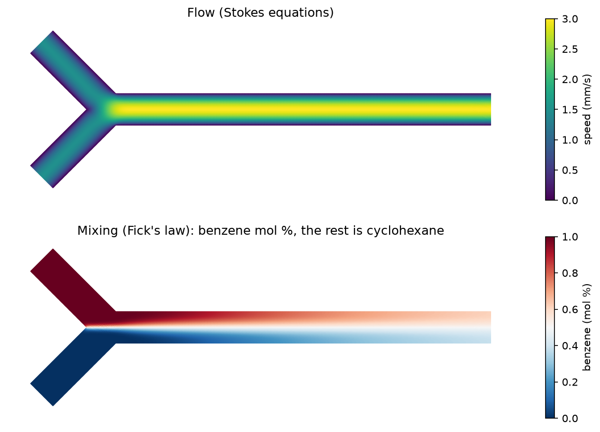
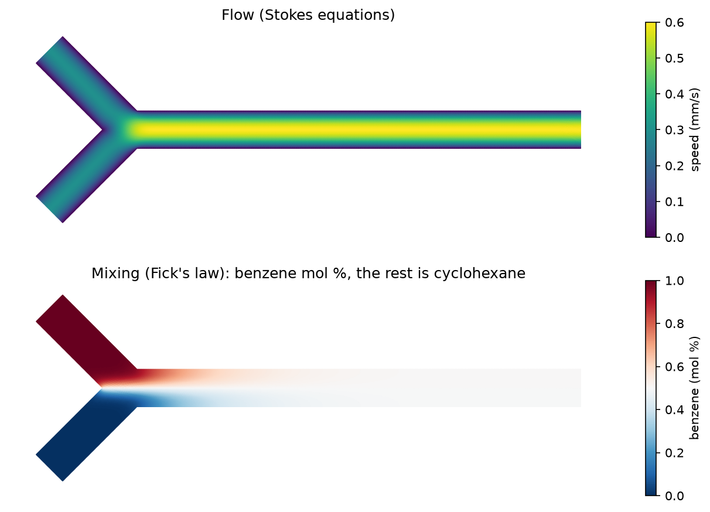
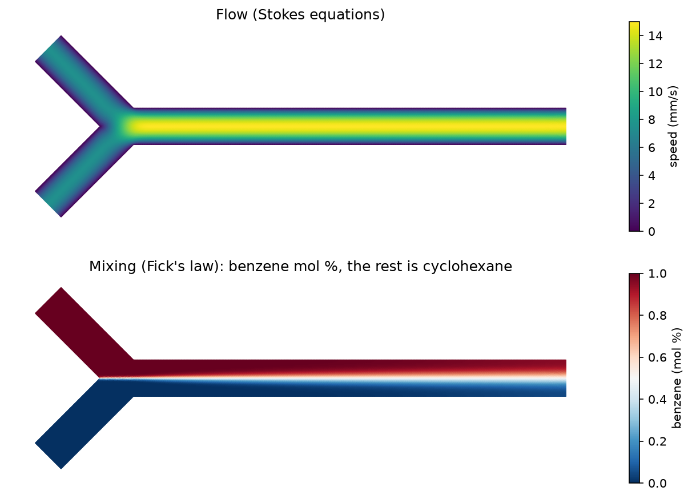

# 2D mixing in a microfluidic Y-junction (Finite Element Method)

A Python model of how a dilute stream of benzene mixes with cyclohexane as they flow through a microfluidic Y-junction, solved with the Finite Element Method (FEM) using the Firedrake library.



## Why I made this

After reading *High-Order Finite Element Methods for Three-Dimensional Multicomponent Convection–Diffusion* by Aaron Baier-Reinio and Professor Patrick Farrell (Oxford Mathematical Institute), I was fascinated by how mathematical modelling can be applied to chemical engineering. Their work models concentrated mixtures in 3D, so I made my own simplified version to learn the method: modelling the mixing of two components in a 2D microfluidic Y-junction, a type of mixer used in chemical, pharmaceutical and biomedical applications.

## My assumptions

- **2D** rather than 3D
- **Dilute** mixture rather than concentrated (cyclohexane with 1 mol % benzene meets pure cyclohexane)
- **Steady state** rather than time-dependent
- Channels are 100 µm wide, liquid enters each inlet at an average of 1 mm/s

## Governing equations

**Flow → Stokes equations.** Navier–Stokes without the inertial and body-force terms. Inertia can be neglected because the Reynolds number is tiny in a microchannel (Re ≈ 0.09), so viscous forces >>> inertial forces.

$$\nabla\cdot\mathbf{u} = 0, \qquad -\nabla p + \mu\nabla^2\mathbf{u} = 0$$

**Mixing → convection–diffusion equation.** A mass balance on the benzene flux (convection + diffusion), with diffusion modelled by Fick's law. Fick's law is valid because the mixture is dilute. For concentrated mixtures, Farrell's group uses the Onsager–Stefan–Maxwell equations instead.

$$\mathbf{u}\cdot\nabla x_B = D_B\nabla^2 x_B$$

## How it works (FEM)

1. The Y-junction is discretised into a mesh of ~16,000 triangles (~33,000 nodes)
2. Boundary conditions are set: Dirichlet (fixed values, e.g. inlet velocity, no-slip walls, inlet benzene) and Neumann (no benzene diffusing through the walls)
3. The PDEs are turned into their **weak form**: multiply by a test function for each node, integrate, integrate by parts and set = 0. This gives one linear equation per node
4. All the equations are solved together as a matrix system, [K]{u} = {F}, first for the flow, then for the mixing

The full step-by-step maths is in [FEM_MATHS.md](FEM_MATHS.md).

## Checks

| Check | Expected | Result |
|---|---|---|
| Peak speed in the main channel (laminar flow: 1.5 × average) | 3.000 mm/s | 3.000 mm/s |
| Average benzene at the outlet (mass balance) | 0.500 mol % | 0.500 mol % |
| Mesh check: benzene near the outlet with 5 µm vs 10 µm triangles | unchanged | 0.6166 mol % both |

## Results

Changing the inlet speed shows how flow speed controls mixing: at **0.2 mm/s** the streams are fully mixed by the outlet, while at **5 mm/s** they leave as two mostly separate streams, because the benzene has less time to diffuse across the channel.

| Slow flow (0.2 mm/s) | Fast flow (5 mm/s) |
|---|---|
|  |  |

## How to run

Requires [Firedrake](https://www.firedrakeproject.org/) (Linux or Apple-silicon Mac; on Windows via WSL), plus:

```bash
pip install ngsPETSc matplotlib
python3 ymixer.py
```

It prints the checks above and saves `ymixer.png`. To try different flow speeds, change `U` at the top of the code.

## References and acknowledgements

- A. Baier-Reinio and P. E. Farrell, *High-order finite element methods for three-dimensional multicomponent convection–diffusion* (arXiv:2408.17390)
- Firedrake demo: [Multicomponent flow: microfluidic non-ideal mixing of hydrocarbons](https://www.firedrakeproject.org/demos/multicomponent.py.html) by Aaron Baier-Reinio and Kars Knook (source of the benzene–cyclohexane diffusivity)
- I used an AI assistant to help develop the code and explain the finite element maths to me; the project idea, modelling choices, testing and my understanding of the maths are my own.
